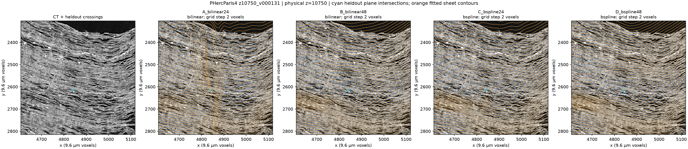

# Experimental cubic gap sampler: real-data development screen

This optional implementation makes Paul's proposed B-spline gap field available for review. It does **not** demonstrate better unwrapping, a speedup, or a production memory saving. Bilinear remains the default. The production comparison is pending a usable baseline; this is not a recommendation to replace an existing fitted model.

Motivation: [Paul's September 15 proposal](https://discord.com/channels/1079907749569237093/1243576621722767412/1549538595461660754) and [September 20 clarification](https://discord.com/channels/1079907749569237093/1243576621722767412/1551009994969718917) target fewer gap parameters and improved smoothness. Existing B-spline velocity fields are separate functionality and supply the shared basis arithmetic. Code and analysis were prepared with AI assistance.

## Real input and comparison

Four 1,000-step fits used PHercParis4, native 9.6 micrometre coordinates, z in [10500, 11500), full XY, seed 20260919, on one RTX 3090. Source baseline: `f07d33be6a00d12ace7d6a9465efe17c78ed7b47`, plus this optional gap implementation. All settings, source and cohorts matched except interpolation and lattice spacing.

There were 27 training fiber files and 9 whole-file development-validation files, with 389 retained validation points. Original explicit-frame annotations were XYZ in the 2.4 micrometre scan: multiply by 0.25 and reverse to ZYX. Patches, tracks, normals, PCLs and outer-shell supervision were disabled. This weak fiber-only baseline retains Cartesian velocity fields; it does not reproduce the team's current production fit. The split is not an independent final test.

| Arm | Interpolation / spacing | Median error, micrometres | Upper-tail error, micrometres | Whole fibers satisfied | Gap scalar slots | Total parameters |
|---|---|---:|---:|---:|---:|---:|
| A | bilinear / 24 | 613.02 | 2350.68 | 0/9 | 2,388,485 | 81,448,362 |
| B | bilinear / 48 | 681.86 | 2650.64 | 0/9 | 586,278 | 79,646,155 |
| C | bspline / 24 | 563.29 | 2107.08 | 0/9 | 2,388,485 | 81,448,362 |
| D | bspline / 48 | 583.80 | 1862.37 | 0/9 | 586,278 | 79,646,155 |

Median error is the median across fibers of each fiber's median distance to its independently snapped native target. Upper-tail error is the median across fibers of each fiber's P90 distance. These metrics do not establish absolute winding identity or connected sheet correctness. The original predeclared gate required at least 20% median improvement against both bilinear arms, no greater than 10% upper-tail regression and no loss of whole-fiber satisfaction. **Neither spline arm passed.** The later maintainer clarification does not change that gate or turn these results into a confirmatory success.

Counts were checked against the actual saved tensors and optimizer groups. Coarsening reduces gap slots by 75.454%, but total parameters by only 2.213%; coarse bilinear gives exactly the same reduction. Included pinned first-column slots number 55 at spacing 24 and 27 at spacing 48. This is allocated capacity, not identifiable degrees of freedom. High-resolution flow alone has 78,720,000 parameters.

One sequential timing pass per arm took A/B/C/D 182.9/165.7/210.0/293.3 seconds. Peak PyTorch reserved CUDA memory was 1.855/1.816/2.195/2.182 GiB. These single-pass figures do not establish a reliable performance difference or whole-GPU residency. All four fits completed with zero nonfinite-gradient steps. Full recorded metrics: [screen_comparison.json](screen_comparison.json).

## CT evidence

This fixed example is from the public [PHercParis4 CT volume](https://vesuvius-challenge-open-data.s3.us-east-1.amazonaws.com/PHercParis4/volumes/20260411134726-2.400um-0.2m-78keV-masked.zarr/). It shows physical native z=10750, with the same CT view and plotting settings in all arms. Orange contours are fitted sheets; cyan is the held-out fiber's plane crossing. The contour sampling grid is two native voxels. All arms depart substantially from visible sheet geometry. No usable new surface is established.

The view was one of nine fixed crops; three were visually inspected. Missing outer-shell supervision permits curves through air, which is not by itself a new algorithm defect. CT and annotations originate from the Vesuvius Challenge; the figure is an evaluation overlay, not newly acquired data.

## Retrospective smoothness diagnostic

After the failed screen and maintainer clarification, a fixed diagnostic sampled existing checkpoints at 63 common reference anchors: winding labels 20/60/100, z 10700/11000/11300, and angles j*pi/4 for j=1..7. Symmetric finite differences used 12/24/48 native voxels (115.2/230.4/460.8 micrometres) along z and reference arc. Angular offsets use the common initial pitch of 16 voxels. Seams and domain edges are excluded. Equal winding labels are not proven anatomical correspondences.

Native radial gap second variation is measured before the flow/linear transforms, not as scan-space normal sheet separation. Complete world-space curve curvature is measured separately. Float64 evaluation of fitted float32 coefficients reduces numerical cancellation; the four evaluations took 3.32 CPU seconds and did not initialize CUDA. This is not a fitting-speed benchmark.

| Direction / step, voxels | Median native gap second variation D/A | D/B | Median surface curve curvature D/A | D/B |
|---|---:|---:|---:|---:|
| z / 12 | 0.394 | 0.242 | 0.844 | 0.781 |
| z / 24 | 0.702 | 0.345 | 0.868 | 0.606 |
| z / 48 | 0.878 | 0.535 | 0.868 | 0.720 |
| arc / 12 | 0.312 | 23.271 | 0.763 | 0.701 |
| arc / 24 | 0.539 | 0.715 | 0.712 | 0.902 |
| arc / 48 | 1.340 | 0.664 | 1.078 | 0.892 |

Below 1 means a smaller diagnostic, not greater correctness. At arc step 12, only 33/63 coarse-grid stencils cross a knot, versus 63/63 fine-grid stencils; the D/B native-gap ratio is strongly affected by within-cell sampling. Every other direction/scale crosses a knot in all 63 stencils. No samples were added after reading results. D's surface-curvature P90 is 36% higher than A at arc step 48. C lowers surface-curvature medians versus A in only two of six conditions. Therefore neither cubic interpolation alone nor coarsening demonstrates uniformly smoother complete surfaces.

Raw values and source/config hashes: [smoothness_diagnostic.json](smoothness_diagnostic.json). Checkpoint hashes in that file are reused from the earlier held-out evaluator, not rehashed by the bounded diagnostic. Curvature includes natural scroll bending; a flatter, incorrectly placed surface can score lower. This is limited development evidence, not a new passed quality gate.

## Validation and next step

The [README test command](../../README.md#optional-cubic-gap-interpolation) passed on Windows using the existing Python environment: **79 passed, 6 skipped, 14 subtests passed** in 12.85 seconds, with 44 PyTorch JIT/Python 3.14 deprecation warnings. The skips require CUDA/Triton; this CPU invocation does not validate them. The focused suite covers independent SciPy agreement, autograd, boundary pinning, seam values, inverse behavior, unchanged default sampling, checkpoint rejection and preview identities. An unrelated pre-existing Windows path assertion in the wider preview suite is outside this focused result. No Ubuntu/macOS run was performed.

For a fresh fit, set `model_gap_expander_interpolation` to `bspline`; keep `model_gap_expander_logit_resolution` explicit. Bilinear coefficients cannot be reinterpreted as spline coefficients. Saved spline capacity growth is rejected, and the eager sampler does not use bilinear Triton kernels. No new dependencies are introduced.

Next: reproduce a usable production checkpoint unchanged, then compare original bilinear, coarser bilinear and coarser spline at matched physical/CT quality. Freeze tolerances before scoring variants; report gap and total parameter counts, whole-fit memory/runtime, boundary/seam behavior and actual sheet placement separately. A complete portable replay bundle for this local development screen is not included here; the implementation and numerical test command are directly runnable in the existing fitter environment. This report records the observed screen, not independent reproduction or production validation.
